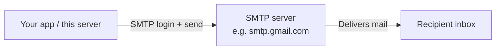
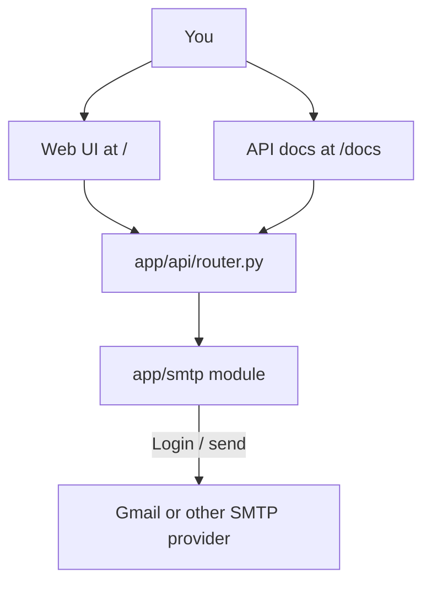
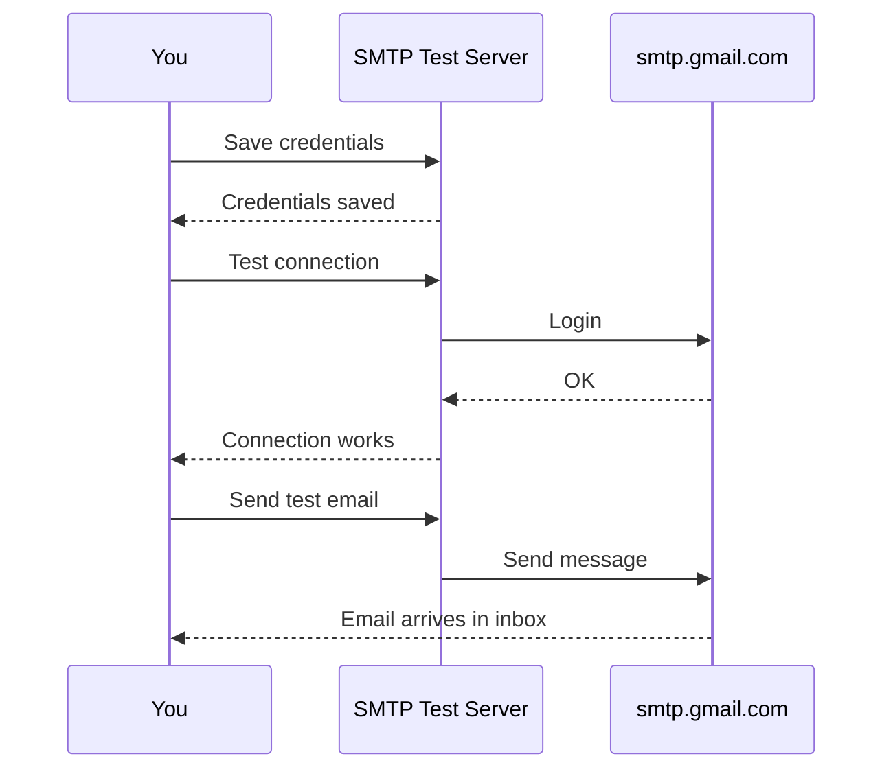
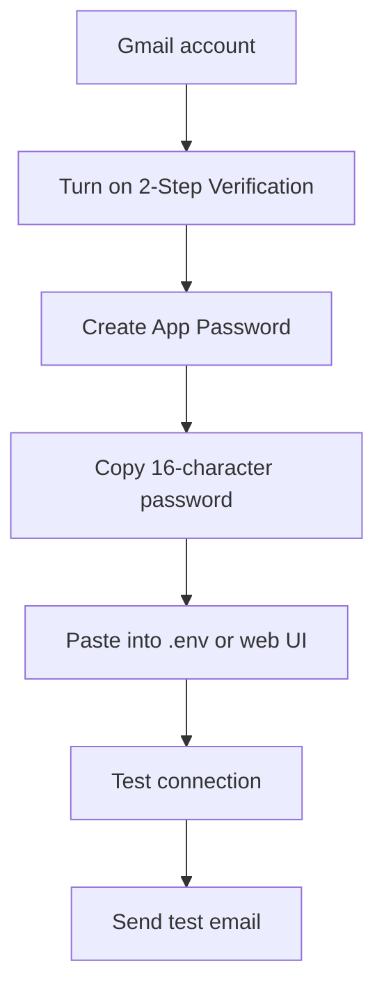
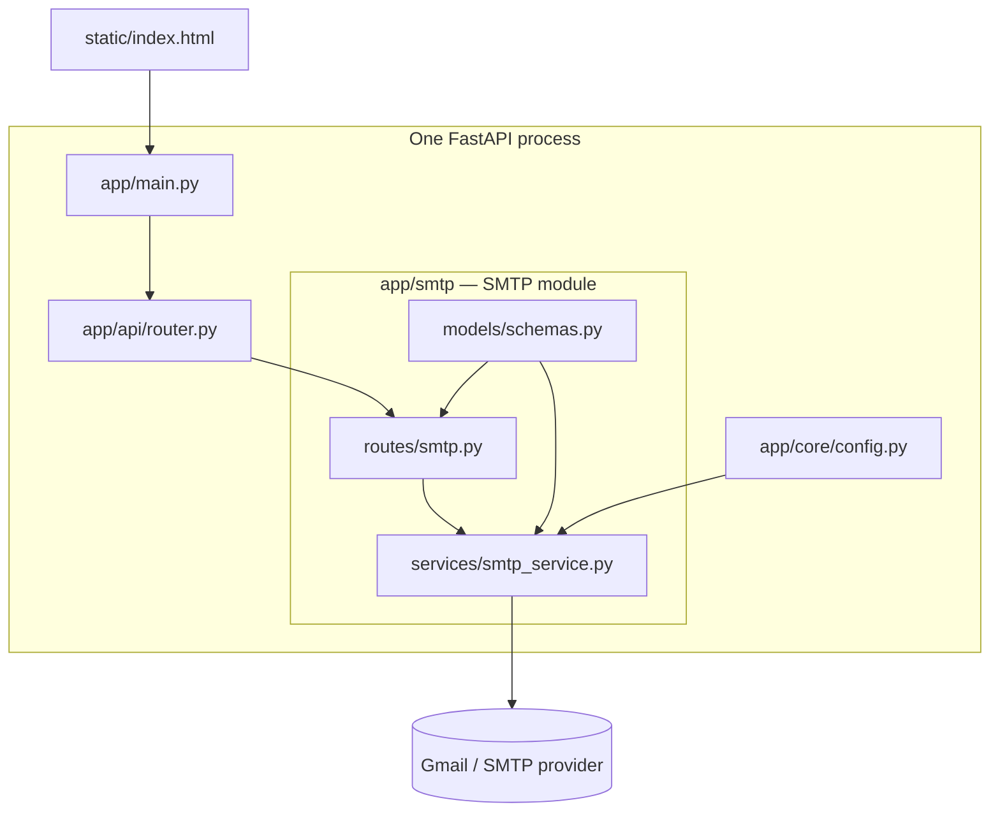

# Gmail / SMTP Test Server

A small **FastAPI** app that helps you check whether your email SMTP setup works.

You can:

1. Save SMTP credentials (Gmail or any provider)
2. Test the SMTP login (no email sent)
3. Send a real test email to yourself

Use the simple web page at `/` or the interactive API docs at `/docs`.

---

## What is SMTP? (plain English)

**SMTP** is the protocol apps use to **send** email.

Think of it like a post office for outgoing mail:



If SMTP credentials are wrong, emails never leave your app.

---

## How this project works



### Typical flow



---

## Quick start (5 minutes)

### 1. Requirements

- Python 3.10+
- A Gmail account **or** any SMTP provider

### 2. Install

```bash
cd Gmail-Server-SMPT-
python3 -m venv .venv
source .venv/bin/activate   # Windows: .venv\Scripts\activate
pip install -r requirements.txt
```

### 3. Add your credentials (optional but recommended)

```bash
cp .env.example .env
```

Edit `.env`:

```env
SMTP_HOST=smtp.gmail.com
SMTP_PORT=587
SMTP_USERNAME=you@gmail.com
SMTP_PASSWORD=your-app-password-here
SMTP_USE_TLS=true
SMTP_USE_SSL=false
SMTP_FROM_EMAIL=you@gmail.com
```

> **Gmail tip:** Normal Gmail passwords often fail. Use an [App Password](https://support.google.com/accounts/answer/185833) (2-Step Verification must be on).

### 4. Run the server

```bash
uvicorn app.main:app --reload --host 0.0.0.0 --port 8000
```

Open:

| Page | URL |
|------|-----|
| Simple web UI | http://127.0.0.1:8000/ |
| Interactive API docs | http://127.0.0.1:8000/docs |
| Health check | http://127.0.0.1:8000/health |

---

## Gmail setup checklist



| Setting | Usual Gmail value |
|---------|-------------------|
| Host | `smtp.gmail.com` |
| Port | `587` (TLS) or `465` (SSL) |
| Username | your full Gmail address |
| Password | **App Password**, not your normal password |
| TLS | `true` for port 587 |
| SSL | `true` for port 465 (then set TLS to `false`) |

---

## API reference (simple)

All SMTP routes live under `/smtp`.

### Check status

```http
GET /smtp/status
```

Shows whether credentials are loaded (password itself is never returned).

### Save credentials

```http
POST /smtp/credentials
Content-Type: application/json
```

```json
{
  "host": "smtp.gmail.com",
  "port": 587,
  "username": "you@gmail.com",
  "password": "xxxx xxxx xxxx xxxx",
  "use_tls": true,
  "use_ssl": false,
  "from_email": "you@gmail.com",
  "from_name": "SMTP Test Server"
}
```

Credentials are kept **in memory** until the server restarts. Prefer `.env` for long-term storage.

### Test connection (no email)

```http
POST /smtp/test-connection
Content-Type: application/json
```

```json
{}
```

Uses saved / `.env` credentials. You can also pass a one-off `credentials` object.

### Send a test email

```http
POST /smtp/send-test
Content-Type: application/json
```

```json
{
  "to_email": "you@gmail.com",
  "subject": "SMTP Test Email",
  "body": "Hello! If you received this, your SMTP setup is working."
}
```

### Clear saved credentials

```http
DELETE /smtp/credentials
```

---

## Project structure (modular monolith)

One app process, but each feature lives in its own folder like a small microservice.

```text
Gmail-Server-SMPT-/
├── app/
│   ├── main.py                      # Composition root (wires everything)
│   ├── core/
│   │   └── config.py                # Shared settings (.env)
│   ├── api/
│   │   └── router.py                # Mounts all module routers
│   └── smtp/                        # SMTP "microservice" module
│       ├── models/
│       │   └── schemas.py           # Request / response shapes
│       ├── routes/
│       │   └── smtp.py              # /smtp HTTP endpoints
│       └── services/
│           └── smtp_service.py      # Connect + send logic
├── static/
│   ├── index.html
│   ├── styles.css
│   └── app.js
├── .env.example
├── requirements.txt
└── README.md
```



Add a future module the same way: create `app/<name>/{models,routes,services}` and include its router in `app/api/router.py`.

---

## Common problems

| Symptom | Likely cause | What to try |
|---------|--------------|-------------|
| Authentication failed | Wrong password / normal Gmail password | Use a Gmail **App Password** |
| Connection timed out | Firewall / wrong host-port | Confirm host/port; try 587 TLS |
| SSL / TLS error | Both SSL and TLS enabled, or wrong combo | Port 587 → TLS only; Port 465 → SSL only |
| Email sent but not received | Spam filter / delay | Check spam; wait a minute |
| `No SMTP credentials configured` | Nothing in `.env` and nothing saved via API | Save credentials or fill `.env` and restart |

---

## Security notes

- Do **not** commit `.env` (it is gitignored).
- App Passwords are still secrets — treat them like passwords.
- This tool is for local testing. Do not expose it publicly without auth.

---

## License

Use freely for personal and project testing.
